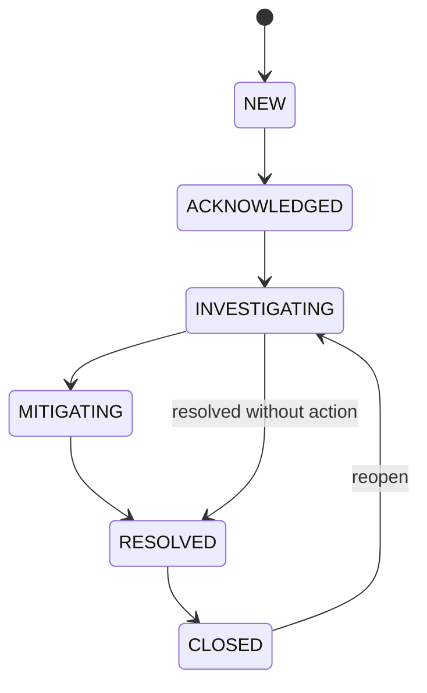

# Cloud Incident Commander — Software Requirements Specification (SRS)

- **Mã tài liệu:** CIC-SRS-001
- **Phiên bản:** 1.1 (design baseline, chưa triển khai)
- **Ngày:** 2026-10-15
- **Trạng thái:** Design baseline đã rà soát; chỉ chứng nhận triển khai sau khi có mã nguồn, kết quả test và AWS evidence
- **Phạm vi cloud:** AWS duy nhất
- **Định hướng:** AI-assisted Incident Management + DevOps/SRE/Security/Data Engineering

## 1. Tầm nhìn và mục tiêu

Cloud Incident Commander (CIC) là nền tảng vận hành dùng để quản lý vòng đời sự cố (incident) trên AWS và các môi trường workload chạy **trên AWS**. CIC thu thập tín hiệu từ alarm, deployment, metrics, logs, security finding và các adapter container platform; tương quan tín hiệu để tạo sự cố; tập hợp evidence; sử dụng Amazon Bedrock để phân tích nguyên nhân có căn cứ; đề xuất runbook; yêu cầu con người phê duyệt trước khi có hành động làm thay đổi hệ thống; sau đó xác minh và xuất postmortem.

**Kịch bản nghiệm thu MVP:** một bản deploy lỗi trên ECS làm tăng HTTP 5xx -> CloudWatch Alarm đổi trạng thái -> EventBridge/SQS gửi event -> CIC tạo incident đúng resource -> thu thập log/metric/deployment -> Bedrock tóm tắt bằng evidence IDs -> SRE phê duyệt rollback task definition đã allowlist -> Step Functions chạy rollback -> verifier xác nhận metric phục hồi -> timeline/audit/postmortem hoàn chỉnh.

## 2. Nhân vật / vai trò

| Vai trò | Quyền |
|---|---|
| Viewer | Xem dashboard, incident, evidence đã được phép đọc, postmortem |
| Operator | Viewer + acknowledge, assign, comment, yêu cầu investigation, đề xuất remediation |
| Approver | Operator + approve/reject remediation cho resource đã được phân quyền; không tự duyệt yêu cầu do chính mình tạo |
| Admin | Cấu hình connector, resource allowlist, policy, user/group, cost gates; không vượt qua approval gate khi xử lý production |
| System | Service role nội bộ, chỉ phạm vi hành động do IAM/resource policy cấp |

MVP một tổ chức (`tenant_id=default`) nhưng mọi record có `tenant_id` để có thể hỗ trợ multi-tenant trong tương lai. **Không cho phép frontend gọi trực tiếp IAM, Bedrock hay DynamoDB.**

## 3. Ranh giới phiên bản

### Có trong MVP (P0-P4)
- Cognito sign-in (Authorization Code + PKCE), RBAC.
- Dashboard incident và trạng thái workload ECS.
- Kết nối AWS CloudWatch alarm + ECS deployment history + log evidence.
- Event normalization, deduplication, correlation, severity, incident timeline.
- Bedrock grounded RCA có trạng thái `INCONCLUSIVE` khi thiếu căn cứ.
- Action plan hữu hạn: `ecs.rollback_task_definition` với điều kiện kiểm tra trước.
- Approval/rejection, Step Functions, verification, complete audit, postmortem.
- Terraform và GitHub Actions OIDC; PR checks, release từ protected branch và manual approval cho production.
- Unit/integration/e2e/security tests; cost guardrails.

### Có trong Full Scope (P5-P7)
- Prometheus/Grafana/ELK cho observability lab; Security findings (GuardDuty/CloudTrail) và analytics S3/Athena.
- EKS/Kubernetes adapter, deployment events, namespace/workload inventory; Jenkins X GitOps lab.
- OpenShift adapter trên ROSA hoặc OpenShift cluster thật trên AWS; Nomad adapter trên AWS EC2.
- Jenkins, GitLab CI/CD, Bitbucket và GitLab repo connectors: ingest verified pipeline/deployment events; thực thi pipeline mẫu.
- RHEL, Packer, Ansible: build/harden image, cấu hình EC2 runners/agents/Nomad/ELK.
- Nâng cấp RBAC, dashboard đa nền tảng, resilience, báo cáo so sánh.

### Ngoài phạm vi v1.1
- Multi-cloud, triển khai trên GCP/Azure hoặc quản lý infrastructure ngoài AWS.
- AI agent có quyền AWS trực tiếp, tự khởi chạy remediation không có approval.
- Shell command tùy ý từ UI, auto-fix mọi loại finding, xóa database, sửa Security Group đại trà.
- Enterprise HA nhiều Region, multi-tenant thanh toán, SIEM đầy đủ, AIOps dự báo tự huấn luyện ML tùy chỉnh.

## 4. Functional requirements

| ID | Requirement | Ưu tiên | Phase | Nghiệm thu tối thiểu |
|---|---|---|---|---|
| FR-001 | Authentication Cognito PKCE + RBAC | P0 | P1 | Endpoint nhạy cảm 401 không token, 403 sai role; token hết hạn bị từ chối |
| FR-002 | Asset inventory ECS services và môi trường | P0 | P1 | Liệt kê có filter, resource ARN, region, môi trường, owner; không dùng wildcard IAM |
| FR-003 | Dashboard incident, KPI, filter/search | P0 | P2 | Lọc theo status/severity/exact resource và incident ID, cursor pagination; không full-text search, không dùng table Scan |
| FR-004 | CloudWatch alarm/event ingestion | P0 | P2 | Alarm đến queue, event validated, retry & DLQ |
| FR-005 | Deployment history & linking | P0 | P1-P2 | Deployment gắn commit SHA, repo, pipeline run, resource, revision |
| FR-006 | Dedup & correlation | P0 | P2 | Cùng fingerprint trong cửa sổ 10 phút chỉ tạo 1 incident đang mở; duplicate không nhân timeline |
| FR-007 | Incident lifecycle | P0 | P2 | NEW → ACKNOWLEDGED → INVESTIGATING → MITIGATING → RESOLVED → CLOSED; timeline lưu actor/time |
| FR-008 | Evidence collection | P0 | P2 | Lấy metrics/logs/deployment trong time window có giới hạn; lưu S3, metadata + SHA-256 |
| FR-009 | AI-assisted investigation | P0 | P3 | RCA có evidence_ids, confidence label, giả thuyết cạnh tranh; INCONCLUSIVE nếu thiếu dữ liệu |
| FR-010 | Safe runbook proposal | P0 | P3-P4 | Chỉ sinh action từ schema và allowlist; UI phân biệt đề xuất với thực thi |
| FR-011 | Approval workflow | P0 | P4 | Có requester/approver khác nhau, TTL 30 phút, quyết định audit đầy đủ |
| FR-012 | ECS rollback remediation | P0 | P4 | Chỉ rollback cluster/service allowlist, best-effort revision drift check + CIC resource lock; fail closed khi phát hiện drift |
| FR-013 | Post-remediation verification | P0 | P4 | Check trạng thái deploy và alarm/metric ổn định 5 phút; UNKNOWN nếu thiếu telemetry |
| FR-014 | Application-enforced append-only audit trail | P0 | P4 | Conditional PutItem cấm overwrite tại application layer; writer không Update/Delete; outbox và export có checksum; không tuyên bố WORM |
| FR-015 | Postmortem generation | P1 | P4 | Timeline, tác động, nguyên nhân, hành động, evidence link, follow-ups; con người chỉnh sửa được |
| FR-016 | Notifications / alert routing | P1 | P5 | Có SNS/email notification mà không chứa token/secrets |
| FR-017 | Prometheus/Grafana integration | P1 | P5 | Metrics workload lab hiển thị và sự cố có link tới panel |
| FR-018 | ELK integration | P1 | P5 | Log từ workload lab vào Elasticsearch qua Logstash/shipper và tra cứu Kibana |
| FR-019 | Security findings integration | P1 | P5 | GuardDuty finding high-severity chuẩn hóa thành signal riêng, không auto-remediate |
| FR-020 | Analytics & reporting | P1 | P5 | S3/Athena truy vấn MTTD/MTTA/MTTR, incident theo nguồn/tác động |
| FR-021 | Kubernetes/EKS connector | P1 | P6 | Pod crash/rollout failure tạo incident có resource mapping |
| FR-022 | Jenkins X GitOps integration | P2 | P6 | Pipeline lab chạy trên EKS, deployment event về CIC |
| FR-023 | OpenShift connector | P2 | P7 | Workload thật trên AWS OpenShift gửi event/metric/log và inventory |
| FR-024 | Nomad connector | P2 | P7 | Job thật trên EC2/Nomad tạo deployment/failure event vào CIC |
| FR-025 | Jenkins & GitLab CI/CD connectors | P2 | P7 | Các pipeline mẫu chạy, webhook signature/secret được xác minh; event có run URL, SHA |
| FR-026 | GitHub, GitLab, Bitbucket SCM linkage | P2 | P7 | Incident xem commit/repo/PR liên quan trên cả 3 hệ thống với scope quyền phù hợp |
| FR-027 | Packer/Ansible/RHEL image lifecycle | P2 | P7 | RHEL image build, hardening, scan, version/provenance; Nomad/runner chạy trên image |
| FR-028 | Operations cleanup & budget guardrails | P0 | P0+ | Lab có TTL/tag, destroy runbook, AWS Budget alarms và thiết lập không tạo ROSA/EKS mặc định |

## 5. Quy tắc nghiệp vụ

- **BR-01:** `incident_id` và `event_id` là ULID/UUID ổn định. Mọi sự kiện phải gắn `source`, `resource_uid`, `occurred_at`, `ingested_at`, `schema_version`, `correlation_id`.
- **BR-02:** `fingerprint = SHA256(tenant_id, source_type, resource_uid, normalized_alert_key)`; tái sử dụng incident còn mở trong cửa sổ correlation mặc định 10 phút. Không gộp incident đã CLOSED.
- **BR-03:** Sự cố chỉ được CLOSED sau RESOLVED; REOPENED tạo timeline event và đổi status về INVESTIGATING.
- **BR-04:** AI output luôn là recommendation; không được dùng trực tiếp làm command hoặc IAM policy.
- **BR-05:** Trong MVP, action thay đổi hạ tầng duy nhất là rollback ECS task definition tới revision đã có sẵn, cùng family và nằm trong release history hợp lệ.
- **BR-06:** Approver phải khác requester, không sửa approval sau khi quyết định; request expires sau 30 phút.
- **BR-07:** Remediation workflow đọc lại ECS state ngay trước action. Nếu task-definition/current deployment/version khác snapshot được duyệt, trả `PRECONDITION_FAILED`.
- **BR-08:** Chỉ một remediation active cho mỗi `resource_uid`; cùng `idempotency_key` trả cùng kết quả.
- **BR-09:** Verification thiếu dữ liệu → `UNKNOWN` chứ không mặc định thành `SUCCESS`; thất bại không tự lặp rollback vô hạn.
- **BR-10:** Không lưu raw Bedrock prompt có secrets, AWS credentials, CI webhook secrets hoặc Step Functions task token trong logs/response.
- **BR-11:** Event có thể đến trễ/trùng/lệch thứ tự. `occurred_at` từ nguồn và `ingested_at` được giữ riêng; xử lý tối thiểu at-least-once, idempotent.
- **BR-12:** Lab không được tạo tài nguyên production; tất cả resources tagged `project=cic`, `environment=lab`, `expires_at`, `owner`.

## 6. Trạng thái và use cases

### Incident state machine

Trạng thái `NEW` có thể được ACKNOWLEDGED nhanh nhưng không được bỏ qua authorization/timeline. Severity gồm `SEV1`, `SEV2`, `SEV3`, `SEV4`.

### Use case UC-001 — Bad ECS deployment
1. GitHub Actions build/test/scan, push digest-tagged image lên ECR, deploy revision mới đến service demo ECS.
2. Pipeline gửi sự kiện deployment chứa SHA, image digest, task definition và actor; hệ thống lưu Deployment.
3. ECS workload trả 5xx; CloudWatch alarm đổi sang ALARM, EventBridge route đến SQS.
4. Ingest normalizes; dedupe/correlation liên kết incident với ECS service và deployment gần nhất.
5. Evidence collector đọc bounded Logs Insights, alarm history, ECS state, metric datapoints; upload S3.
6. Người vận hành yêu cầu AI investigation; Bedrock trả hypotheses có `evidence_ids`, confidence và recommendations dạng schema.
7. Operator chọn rollback về một revision được phép, cung cấp lý do. Approver duyệt sau khi xem `before`/`after` và tác động.
8. Step Functions → preflight Lambda kiểm tra IAM allowlist, concurrency lock, current task definition, target historical revision → ECS `UpdateService` → wait/stabilize → verify.
9. System ghi action result, change audit, verification. Operator resolved & closes; xuất postmortem.

### Use case UC-002 — EKS failed rollout (P6)
EKS rollout failure → event/metric adapter → normalized `kubernetes.deployment_unavailable` → incident → AI phân tích. Mặc định remediation read-only; action trên K8s chỉ được bổ sung khi policy/runbook có thử nghiệm và phân quyền riêng.

### Use case UC-003 — OpenShift/Nomad integration (P7)
Mỗi platform có deployment thật, gây lỗi an toàn có chủ đích trên môi trường lab, thu logs/metrics/events, incident tạo trên cùng dashboard và có liên kết Git/CI. Không giả lập bằng mock khi đánh dấu phase đã hoàn tất.

## 7. Non-functional requirements

| ID | Khía cạnh | Mục tiêu nghiệm thu |
|---|---|---|
| NFR-001 | Latency | p95 API đọc incident < 800ms, không bao gồm Bedrock, đo tải demo 10 concurrent users |
| NFR-002 | Detection | p95 incident created < 120 giây kể từ lúc event **được nhận vào EventBridge**, không tính thời gian alarm đánh giá metric |
| NFR-003 | Availability | MVP mục tiêu demo >= 99% trong các giờ bật hệ thống; không cam kết SLA production |
| NFR-004 | Reliability | SQS DLQ, retry có backoff, replay an toàn, duplicate không tạo remediation lần hai |
| NFR-005 | Security | JWT validation, backend RBAC, IAM least privilege, deny wildcard action cho runner, no AWS static keys trong CI |
| NFR-006 | Encryption | TLS in transit, S3 SSE-S3 tối thiểu, DynamoDB at rest, Secrets Manager cho webhook secrets |
| NFR-007 | Recovery | Terraform rebuild, backup/export data định kỳ; mục tiêu thiết kế RPO <= 24h, RTO <= 4h sau khi backup/restore được kiểm chứng |
| NFR-008 | Audit | 100% mutate actions có actor/timestamp/outcome/correlation-id; writer role không có Update/Delete; application conditional PutItem ngăn overwrite, IAM một mình không bảo đảm WORM |
| NFR-009 | AI quality | 100% RCA hiển thị evidence IDs hoặc trạng thái INCONCLUSIVE; kiểm thử prompt injection & fabricated evidence |
| NFR-010 | Retention | CloudWatch app logs 14 ngày; S3 evidence 90 ngày cho lab; audit >= 365 ngày; configurable theo policy |
| NFR-011 | Accessibility | UI responsive desktop/mobile cơ bản, keyboard navigation, contrast phù hợp |
| NFR-012 | Budget | AWS Budgets alert; provision EKS/ROSA/Jenkins/ELK qua explicit opt-in và cleanup job |
| NFR-013 | Tests | ≥80% line coverage logic domain critical; 100% critical path e2e; dependency + IaC scan trong PR |
| NFR-014 | Observability | Mọi request/event/action có correlation-id; error và DLQ depth có alarm riêng |

*Các ngưỡng NFR là target thiết kế được chốt cho lab, phải đo thực tế để xác nhận; không phải số liệu hiện có.*

## 8. UI sitemap

```text
/login
/dashboard
/incidents
/incidents/detail?id=...   # tabs: overview, timeline, evidence, AI, actions, audit
/resources
/resources/detail?id=...
/deployments
/approvals
/analytics              # P5
/connectors             # P5-P7
/admin/policies
/admin/audit
/admin/cost
```
Với Next.js `output: 'export'`, các trang `/incidents/[id]` và `/resources/detail?id=...` được thực hiện bằng dynamic client-side routing không phụ thuộc SSR, ví dụ `/incidents?incident_id=...` hoặc static route `/incidents/detail?id=...`, để không vi phạm yêu cầu `generateStaticParams` cho static export. Không sử dụng Next.js Route Handlers, Server Actions hay cookie-based server auth.

## 9. Acceptance/UAT cuối MVP

- UAT-01: Deploy lỗi ECS; có incident và được link đúng deployment, resource, commit SHA.
- UAT-02: Gửi event trùng 5 lần; chỉ một incident và một timeline event mang `event_id` đó.
- UAT-03: Backend trả 401/403 cho authz sai; Viewer không approve được.
- UAT-04: AI thiếu evidence -> INCONCLUSIVE; tuyệt đối không bịa source IDs.
- UAT-05: Operator đề xuất rollback, self-approval bị 403; Approver khác duyệt thành công.
- UAT-06: ECS bị đổi revision giữa lúc request approval và execution -> PRECONDITION_FAILED, không gọi ECS UpdateService.
- UAT-07: Callback lặp/timeouts -> không chạy action hai lần; action logs đầy đủ.
- UAT-08: ECS rollback thành công và alarm phục hồi -> `VERIFIED`; alarm tiếp tục ALARM -> `FAILED`, thiếu telemetry -> `UNKNOWN`.
- UAT-09: Có postmortem + audit trail có thể export; không có secret trong log/evidence.
- UAT-10: `terraform destroy` lab sạch; resource trọng yếu của core không bị xóa theo nhầm môi trường.

## 10. Quy tắc thay đổi scope

Mọi feature ngoài FR list yêu cầu issue gồm `request`, `why`, `security impact`, `cost impact`, `dependency`, `phase` và ADR. Không đổi AWS-only, Next.js/TypeScript, GitHub Actions-primary hoặc human-approved remediation khi không có quyết định thay thế được ghi rõ.


## 11. Clarifications chuẩn v1.1 (normative)

1. **Single-tenant runtime:** toàn bộ v1.1 chỉ phục vụ một tenant mặc định, nhưng resource key phải hash từ `tenant_id + canonical_resource_uid`; kiểm tra `tenant_id` ở mọi API. Multi-tenant billing và isolation chưa nằm trong scope.
2. **Incident search:** exact incident ID, exact resource, status và severity (severity được filter server-side sau Query theo status với giới hạn scan pages rõ ràng). Không hứa full-text cho MVP; tìm kiếm đa trạng thái được merge có cursor opaque, không dùng `Scan`.
3. **Timestamps:** `occurred_at` là thời gian sự kiện nguồn (nullable nếu nguồn không cung cấp, sử dụng `ingested_at` theo fallback được gắn cờ), `ingested_at` do CIC tạo; `observed_at` bị loại khỏi contract.
4. **Verification:** chỉ `VERIFIED | FAILED | UNKNOWN`; trạng thái action `PENDING_APPROVAL | APPROVED | REJECTED | RUNNING | SUCCEEDED | FAILED | EXPIRED | PRECONDITION_FAILED | VERIFICATION_UNKNOWN` được thống nhất riêng.
5. **Reopen:** CLOSED chỉ được reopen bởi Operator/Admin có lý do; tạo timeline `INCIDENT_REOPENED`, tăng version, không hồi sinh approval/action cũ; nếu fingerprint lock thuộc incident khác thì không giành lock của incident đó. Postmortem trước giữ lịch sử, bản cập nhật tạo version mới.
6. **Approver/Admin MFA:** user pool yêu cầu MFA cho tài khoản có nhóm Approver/Admin trước khi dùng quyền; backend kiểm tra authorization tại thời điểm quyết định và deny khi không chứng minh được authentication assurance phù hợp. Group admin không bypass separation of duties.
7. **Auth boundary:** `/v1/*` JWT Cognito (ngoại trừ health); `/webhooks/{connector_id}` dùng HMAC hoặc signature chính hãng từng provider + chống replay, KHÔNG sử dụng Cognito JWT; không expose route này trước phase connector.
8. **ECS workload:** P1 dùng Fargate task `awsvpc` ở public subnet, `assignPublicIp=ENABLED`, outbound qua IGW, SG không có inbound; không có ALB/NAT mặc định. Synthetic HTTP client trong cùng task gọi `localhost`, tạo structured access logs và CloudWatch metric filter 5xx; tài nguyên lab có thời hạn. Public IPv4 và Fargate vẫn có chi phí.
9. **Event pipeline:** P1 custom EventBridge **Classic** bus `cic-events` và deployment-recorder target; P2 default AWS event bus CloudWatch alarm rule forward có lọc vào `cic-events`, sau đó route SQS->Lambda. Không giả định CloudWatch gửi trực tiếp custom bus.
10. **AI:** kết quả là thông tin tham khảo; evidence ID phải tồn tại trong incident, không cho phép model điều khiển ECS/IAM. Không có AI autonomous AWS writes.
11. **Audit:** mô hình `core mutation + outbox` transactional; audit writer `PutItem` dùng condition; writer's IAM deny Update/Delete nhưng không thể ép ConditionExpression bằng IAM; S3 Object Lock (nếu bật) cần riêng phí, retention và kiểm soát quản trị. Không gọi DynamoDB immutable/WORM.
12. **Approval:** TTL logic 30 phút; không phụ thuộc DynamoDB TTL để expire tức thời; callback token không ra browser. Negative tests bắt buộc với self-approval, stale JWT/group, double-submit, stale resource revision.
13. **MVP read-path:** Inventory Collector P1-10 định kỳ 5–15 phút, resource list API truy vấn bảng DynamoDB; P1-09 nhận deployment event, P1-06 publish signed AWS principal `PutEvents` và link deployment record. Không dùng fake sample data để pass gate.
14. **Acceptance:** Mọi yêu cầu FR phải có ít nhất một backlog story và test ID trong `08_REQUIREMENT_TRACEABILITY.md`. Các tham số triển khai thực tế và cost phải thông qua manual approval trước `terraform apply`.

**API read-path clarification:** evidence access requires `POST /v1/evidence/{evidence_id}/access` after backend authorization with 60-second presigned S3 URL; raw ECS ARNs are not embedded unencoded in path segments.
