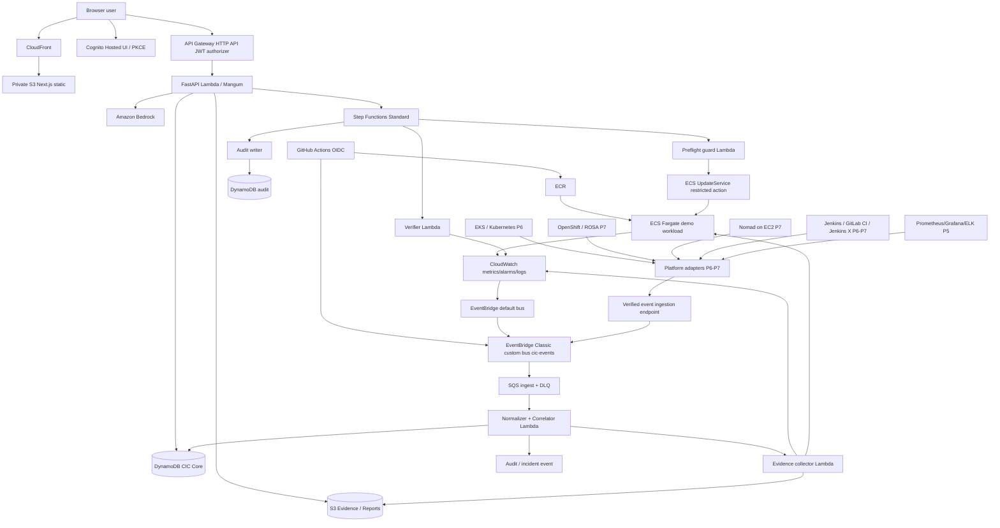
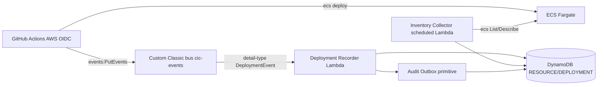

# Cloud Incident Commander — Service-level Architecture

- **Mã:** CIC-ARCH-001
- **Version:** 1.1 / 2026-10-15
- **Boundaries:** AWS-only workloads; GitHub/GitLab/Bitbucket are external source-control/CI coordination services, not cloud infrastructure hosting CIC.

## 1. Architecture decision records (ADR)

| ADR | Quyết định | Lý do / hệ quả |
|---|---|---|
| ADR-001 | AWS là cloud duy nhất | Không deploy lên GCP/Azure. |
| ADR-002 | Next.js + TypeScript `output: 'export'` → private S3 origin + CloudFront OAC | Tối ưu chi phí, dùng Cognito PKCE phía trình duyệt. Không dùng SSR, Next server actions, dynamic server route, server cookies. |
| ADR-003 | FastAPI + Mangum trên AWS Lambda phía sau API Gateway HTTP API | MVP serverless, scaling theo request; business logic tách khỏi Lambda handler. |
| ADR-004 | DynamoDB on-demand là system of record, S3 cho evidence | Không vận hành RDS 24/7. Dùng conditional writes, transactions và truy cập theo PK/GSI. |
| ADR-005 | EventBridge + SQS + DLQ + Lambda | Event driven, retry & replay; at-least-once nên bắt buộc idempotency. |
| ADR-006 | Bedrock chỉ cung cấp investigation/recommendation | Không cấp tool credentials cho AI; validate JSON schema và evidence_id. |
| ADR-007 | Step Functions Standard + approval callback + restricted runner | Human-in-the-loop, timeout và full audit; không nhận arbitrary shell commands. |
| ADR-008 | ECS Fargate làm workload cố ý gây sự cố ban đầu; EKS P6, OpenShift/Nomad P7 | Tránh multi-cluster cost; vẫn đảm bảo integration thật ở full scope. |
| ADR-009 | GitHub Actions là CI/CD chính, OIDC→AWS | Jenkins/GitLab CI/Jenkins X là integration lab, không cạnh tranh trách nhiệm release core. |
| ADR-010 | Policy-as-code + IAM least privilege + cost gates | AWS Budgets, TTL lab, protected manual approval trước cluster đắt tiền. |

## 2. Sơ đồ toàn hệ thống



**Không vẽ AI nối trực tiếp ECS/EKS:** AI chỉ trả phân tích; chính Step Functions + guardrails mới có quyền thực thi.

## 3. Ownership và contracts ở cấp service

| ID | Service/component | Runtime | Input | Output / storage | Permission boundary |
|---|---|---|---|---|---|
| SVC-01 | Web Console | Next.js static S3/CloudFront | Browser OIDC/JWT, API fetch | UI dashboard và actions | Public read qua CloudFront; S3 origin private OAC |
| SVC-02 | Identity & Authorization | Cognito + API Gateway JWT + FastAPI policy | OAuth code PKCE / claims | identity, roles, authz decision | Backend validate tenant/resource authorization; FE chỉ hide control |
| SVC-03 | API/BFF | FastAPI + Mangum + Lambda | HTTPS `/v1/*` | DynamoDB, S3 pre-signed GET, SF and Bedrock requests | No direct broad AWS mutation; roles scoped |
| SVC-04 | Deployment Recorder | Lambda/API | Trusted pipeline event | `DEPLOYMENT#` record, link SHA + digest | GitHub AWS OIDC PutEvents with bus restriction |
| SVC-05 | Event Normalizer | SQS-triggered Lambda | CloudWatch/CI/K8s/etc events | Canonical `SignalEvent v1.1` | Schema validation, rate limit, DLQ |
| SVC-06 | Dedupe & Correlator | Lambda + DynamoDB | Normalized signal | Incident & timeline writes | Atomic conditional updates; idempotency |
| SVC-07 | Inventory Collector | Scheduled Lambda | Allowlisted AWS resource refs | Resource inventory | ECS/CloudWatch read-only IAM scoped |
| SVC-08 | Evidence Collector | Async Lambda | incident/resource/time window | S3 JSON evidence + SHA-256 reference | Bounded CloudWatch query & ECS Describe calls; redact |
| SVC-09 | AI Investigator | Async Lambda + Bedrock | Curated evidence IDs and snippets | `ANALYSIS#id` report; S3 report | Bedrock InvokeModel only; never mutates AWS |
| SVC-10 | Runbook/Policy Validator | FastAPI domain / Lambda | Structured proposed action | Allowed/denied + safe target revision | Deterministic JSON-schema, resource/action allowlists |
| SVC-11 | Approval Manager | FastAPI + DDB + SF callback | Requester proposal; approver decision | APPROVAL states + callback (encrypted token) | Non-self-approval, role+resource check, expiry, compare-and-swap |
| SVC-12 | Remediation Orchestrator | Step Functions Standard | approved action reference | State transitions, retries, result | Only starts action with approval record |
| SVC-13 | Preflight/Executor | Lambda | Action / expected revision | ECS UpdateService result | Dedicated least privilege `ecs:UpdateService` on explicit ARN |
| SVC-14 | Verifier | Lambda | ActionId + serviceId + expected revision | VERIFIED / FAILED / UNKNOWN | ECS/CloudWatch read-only |
| SVC-15 | Audit Writer | Lambda / shared module | All privileged decisions and mutations | Append-only DDB Audit, S3 export P5 | App uses conditional `PutItem`, IAM writer denies Update/Delete; IAM alone does not guarantee conditional Put |
| SVC-16 | Reporting | Lambda/Athena later | Closed incidents, events, audit refs | Postmortem in S3, analytics dataset | Read-only analytics |
| SVC-17 | Platform Adapter SDK | Python schema+ingestion API | EKS/ROSA/Nomad/CI signed events | Canonical SignalEvent | Connector-specific scoped credentials, no arbitrary commands |
| SVC-18 | Observability Lab | Prometheus/Grafana/Elastic components | Selected telemetry | Dashboards/indices and incident links | Lab-only EC2/EKS, retention caps |

**Implementation topology:** SVC-03 có thể gom chung `api` Lambda cho MVP; SVC-05/06 chung `ingest-worker` Lambda; SVC-07/08 `evidence-worker` Lambda; SVC-09 `investigator` Lambda; SVC-13/14 `remediator` và `verifier` Lambda riêng để cô lập quyền IAM. Đây là các deployable units, không bắt buộc mỗi domain service chạy thành microservice độc lập.

## 4. Network/security layout

```text
AWS account (dev/lab; chỉ 1 region cho MVP)
├── Edge: CloudFront HTTPS → S3 origin private (OAC)
├── Auth: Cognito user pool + Hosted UI
├── Public managed endpoint: API Gateway HTTP API → Lambda (JWT authorizer)
├── Data: DynamoDB on-demand, private S3 evidence, Secrets Manager
├── Event: EventBridge custom bus, SQS, DLQ, Step Functions
├── Monitoring: CloudWatch, CloudTrail S3 trail, Budget/alarms
└── VPC: public/private subnets for ECS workload, later EKS/EC2 labs
    ├── ECS Fargate demo service (lab; public subnet, public IPv4, no ingress, synthetic localhost HTTP)
    ├── EKS Kubernetes workloads (P6; provision on demand)
    └── EC2 RHEL / Nomad / Jenkins / ELK (P7; off outside test windows)
```

- Các Lambda sử dụng AWS public managed APIs có thể chạy **ngoài VPC** để tránh NAT Gateway khi không cần truy cập tài nguyên private. Nếu cần truy cập ECS internal API, thiết kế VPC endpoints/VPC Lambda riêng trước; không tạo NAT mặc định.
- **MVP Fargate network profile (fixed):** ECS task chạy trong public subnet có route IGW, `awsvpc`, `assignPublicIp=ENABLED` cho outbound HTTPS tới ECR/CloudWatch; SG task **không inbound**. Không tạo NAT Gateway, ALB hay custom domain. Ghi nhận phí Fargate, public IPv4, logs và network. ALB chỉ thuộc option phase sau, không là thành phần UAT MVP.
- **5xx deterministic harness:** container app có HTTP endpoint loopback; một synthetic load generator chạy trong cùng ECS task, gọi `http://127.0.0.1:<port>/probe` với mode healthy/faulty; app emits one JSON access log/request `status_code` và metric filter CloudWatch đếm 5xx. CloudWatch Alarm từ metric-filter này tạo state-change AWS event trên default EventBridge bus. Test phải chứng minh request thật trả HTTP 500 và alarm đổi trạng thái (không dùng ALB 5xx giả định).
- Lambda/API đi ngoài VPC; không phụ thuộc ECS inbound/egress qua API. Deployment `PutEvents` vào bus CIC từ GitHub Actions role giới hạn.
- Static export đặt `trailingSlash: true`; CloudFront Function rewrite path `/incidents/detail/` thành `/incidents/detail/index.html` (và các route tương tự), tránh deep-link 403/404 khi dùng S3 REST origin. CloudFront OAC vẫn giữ origin private.
- Không cần Route 53 / ACM custom domain trong MVP: dùng HTTPS domain mặc định CloudFront, Cognito, API Gateway và cấu hình callback/CORS theo chính xác domain đó.
- CloudTrail và CloudWatch logging có retention. CloudTrail trail storage trong S3 do lifecycle quản lý. GuardDuty P5 là tùy chọn theo budget (có chi phí).
- S3 bucket access block public, versioning cho critical evidence, bucket policy TLS-only và SSE. Secrets được lưu Secrets Manager, không lưu trong Git hoặc task definition plain text.

## 5. Event contracts — normative v1.1

**Source of truth:** `11_EVENT_SCHEMAS/*.schema.json`; the snippets below are synthetically generated and must be validated against those exact schemas. AWS CloudWatch native alarms are an **EventBridge AWS envelope** (`CloudWatchAlarmEventEnvelope.schema.json`), not already a canonical `SignalEvent`. The normalizer sets `ingested_at` (it does not trust producer input), resolves resource UID and correlates evidence; `occurred_at` is source time or null with fallback flag.

### Canonical SignalEvent v1.1 (normalized)

```json
{
  "schema_version": "1.1",
  "event_id": "01KB12345678ABCDEFGHJKLMNP",
  "tenant_id": "default",
  "source": "aws.cloudwatch",
  "source_type": "cloudwatch.alarm",
  "resource_uid": "arn:aws:ecs:us-east-1:111122223333:service/cic-demo/api",
  "normalized_alert_key": "cic-demo-api-http-5xx",
  "occurred_at": "2026-10-15T09:00:00Z",
  "ingested_at": "2026-10-15T09:00:04Z",
  "correlation_id": "corr-01KB12345678",
  "payload_ref": "s3://cic-evidence-example/raw/events/evt1.json",
  "severity": "SEV2",
  "missing_occurred_at": false
}
```

### DeploymentEvent v1.1 (GitHub Actions producer)

```json
{
  "schema_version": "1.1",
  "event_id": "01KB12345678DEPLABCDEF1234",
  "tenant_id": "default",
  "resource_uid": "arn:aws:ecs:us-east-1:111122223333:service/cic-demo/api",
  "occurred_at": "2026-10-15T08:57:00Z",
  "ingested_at": "2026-10-15T08:57:04Z",
  "source": "github.actions",
  "commit_sha": "aaaaaaaaaaaaaaaaaaaaaaaaaaaaaaaaaaaaaaaa",
  "image_digest": "sha256:bbbbbbbbbbbbbbbbbbbbbbbbbbbbbbbbbbbbbbbbbbbbbbbbbbbbbbbbbbbbbbbb",
  "task_definition_arn": "arn:aws:ecs:us-east-1:111122223333:task-definition/cic-demo:9",
  "pipeline_run_id": "149000",
  "pipeline_run_url": "https://github.com/example/cloud-incident-commander/actions/runs/149000",
  "deployment_status": "SUCCEEDED",
  "correlation_id": "corr-01KB12345678"
}
```

The producer signs its AWS PutEvents call by STS assumed role (GitHub OIDC) restricted to `cic-events` bus; deployment recorder runs in P1 and writes resource-linked history. Other CI providers use provider-verified webhook ingress in P7, then are normalized. Reserved enums in schema are binding; non-matching versions go DLQ rather than silently coercing.

## 6. Message delivery và consistency

1. EventBridge rule lọc alarm status `ALARM` và deployment events tới queue SQS. Có DLQ, visibility timeout phù hợp Lambda, maximum receives, jitter retry.
2. `ingest-worker` validate JSON Schema, HMAC hoặc trusted EventBridge principal, normalize resource UID.
3. Ghi `cic_dedupe` bằng conditional PutItem `attribute_not_exists(event_id)`; nếu trùng kết thúc thành công. Nếu write core chưa thành công sau khi tạo dedupe marker, dùng trạng thái `PROCESSING/COMMITTED` hoặc transaction write để tránh mất event. Khuyến nghị `TransactWriteItems` khi cùng event/dedupe/core incident item.
4. Correlator đọc mapping fingerprint và status theo strongly consistent key (không dựa trên GSI eventual consistency để quyết định uniqueness). Atomic condition lock cho fingerprint.
5. Tạo/update incident cùng timeline event idempotently. Publish `incident.created` / `incident.updated` vào bus sau write thông qua transactional outbox pattern; retry outbox publisher để tránh mất event giữa DDB write và EventBridge.
6. Evidence collector xử lý async từ incident event; giới hạn log query theo `resource_uid`, source group, time window mặc định -15/+5 phút, max bytes, max records; lỗi được đánh dấu partial.
7. S3 lưu evidence body, DDB chỉ lưu ref/metadata/digest. Không dùng URL pre-signed dài hạn, chỉ cấp link ngắn theo RBAC.

## 7. AI RCA contract

Input: `{analysis_id, incident_id, evidence_manifest:[{evidence_id,type,timestamp,summary,sha256}], bounded_context, allowed_runbook_catalog}`. IDs do CIC cấp; context được sanitize/redact, không nhận nguyên văn secret hay untrusted instruction.

Report phải validate `11_EVENT_SCHEMAS/AIAnalysisReport.schema.json`; ví dụ dưới đây trùng fixture `11_EVENT_SCHEMAS/fixtures/ai_analysis_report_valid.json`:
```json
{
  "schema_version": "1.1",
  "analysis_id": "11111111-2222-4333-8444-555555555555",
  "incident_id": "aaaaaaaa-bbbb-4ccc-8ddd-eeeeeeeeeeee",
  "status": "COMPLETE",
  "confidence": "MEDIUM",
  "evidence_ids": ["evidence-0001", "evidence-0002"],
  "summary": "A rollout may have increased HTTP 5xx",
  "hypotheses": [
    "The new task definition introduced HTTP errors"
  ],
  "missing_evidence": [],
  "recommended_action": {
    "action_type": "ecs.rollback_task_definition",
    "resource_uid": "arn:aws:ecs:us-east-1:111122223333:service/cic-demo/api",
    "target_revision": "arn:aws:ecs:us-east-1:111122223333:task-definition/cic-demo:7"
  }
}
```
- `hypotheses` là danh sách chuỗi; `confidence` và `evidence_ids` áp dụng cho toàn báo cáo. `confidence` enum `LOW|MEDIUM|HIGH`, không xem đó là xác suất được hiệu chuẩn.
- `recommended_action` là một object rollback hoặc `null`; v1.1 chưa hỗ trợ danh sách action. `model_id` và `prompt_version` do backend ghi vào metadata Analysis từ cấu hình thực tế, không lấy từ model output.
- Backend gắn `schema_version`, `analysis_id`, `incident_id` từ request đã xác thực trước khi validate report; loại action không thuộc danh mục, evidence_id ngoài evidence manifest của incident, target ARN ngoài scope và malformed JSON.
- Nếu evidence không đủ hoặc parser fail, trả `INCONCLUSIVE`/`FAILED` với `recommended_action=null`, không tự đoán. JSON Schema kiểm tra hình dạng; policy validator phải kiểm tra các ràng buộc ngữ nghĩa này.
- AI output không phải source of truth; chỉ chính sách deterministic tạo `approval_request` hợp lệ.

## 8. Approval → remediation sequence

```mermaid
sequenceDiagram
  participant Op as Operator UI
  participant API as FastAPI
  participant DB as DynamoDB
  participant SF as Step Functions
  participant Ap as Approver UI
  participant Ex as Preflight/Executor
  participant ECS as ECS
  participant Vf as Verifier
  Op->>API: POST action request (idempotency key)
  API->>DB: Validate policy + create PENDING approval
  API->>SF: Start approval workflow
  SF->>DB: Store encrypted callback token + expiry (via Lambda)
  Ap->>API: POST approve / reject
  API->>DB: Conditional decision, check role & different actor
  API->>SF: SendTaskSuccess(decision) with server-only token
  alt approved
    SF->>Ex: preflight expected/current revision + allowlist + lock
    Ex->>ECS: UpdateService(to approved historical revision)
    SF->>Vf: Poll stabilization + alarm window
    Vf->>DB: VERIFIED / FAILED / UNKNOWN
  else rejected/expired
    SF->>DB: mark REJECTED / EXPIRED; no action
  end
  SF->>DB: append action/audit/timeline
```

- Callback token là secret ngắn hạn: chỉ backend/internal Lambda truy cập, encrypted at rest, không xuất frontend/logs, stale token sẽ bị reject.
- **Single executor:** Step Functions không thực thi nếu status approval không `APPROVED`, policy version không khớp hoặc resource không còn allowlisted.
- **Audit delivery:** mọi mutation quan trọng ghi core change và `OUTBOX#...` trong cùng DynamoDB transaction; audit writer idempotently ghi `cic_audit` bằng conditional PutItem. Nếu chuyển audit bị lỗi, DLQ/replay phải bảo toàn outbox; tuyệt đối không coi audit chưa chuyển là đã hoàn tất.
- SVC-13 thực hiện drift check kiểu best-effort bằng re-read `DescribeServices` trước UpdateService; AWS ECS không có universal CAS parameter cho UpdateService, vì vậy còn race nhỏ giữa read và write. Giảm rủi ro bằng DynamoDB resource lock, chặn đồng thời **các thao tác từ CIC**; drift phát hiện trước UpdateService kết thúc action với `PRECONDITION_FAILED`. Tiếp tục giám sát sau action; không tuyên bố chống hoàn toàn thay đổi bên ngoài CIC.
- Verify check rollout stable, target task definition và alarm OK duy trì 5 phút; timeout → `UNKNOWN`/`FAILED`.

## 9. API contract v1.1 (summary; OpenAPI is authoritative)

All endpoints prefix `/v1`, JSON, UTC ISO timestamps, RFC7807-like error `{code,message,correlation_id}`, pagination cursor (`next_cursor`). Auth JWT required except `/healthz` internal/minimal.

| Method | Endpoint | Role | Description |
|---|---|---|---|
| GET | `/healthz` | Public limited | Readiness without secrets |
| GET | `/incidents?status=&severity=&cursor=` | Viewer | Incident summary, paginated |
| GET | `/incidents/{id}` | Viewer | Incident details |
| GET | `/incidents/{id}/timeline` | Viewer | Timeline ordered by occurred_at + sequence |
| POST | `/incidents/{id}/ack` | Operator | Acknowledge with optimistic version |
| POST | `/incidents/{id}/transition` | Operator | Lifecycle transition, if allowed |
| GET | `/incidents/{id}/evidence` | Viewer | Evidence metadata; separately issue short-lived presigned GET |
| POST | `/incidents/{id}/investigations` | Operator | Trigger async grounded RCA |
| GET | `/incidents/{id}/analyses` | Viewer | List AI findings |
| POST | `/incidents/{id}/actions` | Operator | Request allowlisted action; require `Idempotency-Key` |
| GET | `/approvals?status=PENDING` | Approver | Pending approvals scoped by permission |
| POST | `/approvals/{id}/decision` | Approver | Approve/reject once with expected version |
| GET | `/actions/{id}` | Viewer | Workflow state and verification |
| GET | `/resources` | Viewer | Inventory |
| GET | `/resources/{id}/deployments` | Viewer | Deployment history |
| POST | `/postmortems/{incident_id}/generate` | Operator | Generate draft |
| GET | `/audit?from=&to=` | Admin | Access-controlled audit view |
| POST | `/webhooks/{connector_id}` | System | Verified CI/platform webhook → EventBridge (P5-P7) |

Example `POST /v1/incidents/{id}/actions`:
```json
{
  "action_type": "ecs.rollback_task_definition",
  "resource_uid": "aws:...:ecs:cluster/demo:service/api",
  "target_revision": "arn:aws:ecs:...:task-definition/demo:7",
  "expected_current_revision": "arn:aws:ecs:...:task-definition/demo:8",
  "reason": "Rollback suspected bad release",
  "incident_version": 4
}
```
Returns `202 Accepted` with `{action_id,approval_id,status:"PENDING_APPROVAL"}`; never claims rollback finished. `POST decision` must accept decision, reason and expected version; API is idempotent on repeated decision.

**API v1.1 read contract corrections:** `GET /v1/resources/{resource_id}`, `POST /v1/evidence/{evidence_id}/access` (authorized presigned 60-second GET), and `GET /v1/postmortems/{incident_id}` are normative in OpenAPI; route path `resource_id` is an opaque URL-safe identifier rather than raw ARN containing slashes. POST postmortem generation returns `202 AsyncAccepted`.

## 10. Code/repository structure

```text
cloud-incident-commander/
├── apps/
│   └── web/                     # Next.js + TS + Tailwind, static export
├── services/
│   ├── api/                     # FastAPI routers/domain/policies
│   ├── ingest-worker/           # normalization + dedupe + correlation
│   ├── evidence-worker/         # CloudWatch/ECS collectors
│   ├── ai-investigator/         # Bedrock grounded RCA
│   ├── remediation-worker/      # preflight / executor / verification
│   └── audit-exporter/
├── packages/
│   ├── contracts/               # Pydantic + JSON Schema, OpenAPI
│   ├── domain/                  # incident lifecycle, runbooks, policy
│   ├── adapters/                # AWS first, then K8s/ROSA/Nomad/CI
│   └── ui/                      # shared UI components
├── workloads/
│   ├── faulty-ecs-demo/
│   ├── k8s-demo/
│   ├── openshift-demo/
│   └── nomad-demo/
├── labs/
│   ├── jenkins/
│   ├── gitlab-ci/
│   ├── jenkins-x/
│   ├── packer-rhel/
│   ├── ansible/
│   └── observability-elk/
├── infra/
│   ├── modules/                 # edge, auth, api, event, data, IAM, ECS, EKS ...
│   └── environments/dev/        # core vs lab opt-in tf states
├── .github/workflows/
│   ├── ci.yaml
│   ├── deploy-web.yaml
│   ├── deploy-api.yaml
│   ├── deploy-demo.yaml
│   ├── terraform-plan.yaml
│   └── terraform-apply.yaml
├── docs/adr/
├── tests/contract/ integration/ e2e/ security/
└── Makefile
```

Pipeline rules: PR → lint/test/scan/terraform plan, never deploy; protected `main` → build/push digest and deploy dev after checks; prod path manual approval; IAM GitHub OIDC subject restricted by repo/branch/environment. Never use long-lived AWS access keys.

## 11. Integration matrices & real-workload proof

| Công nghệ | Nơi chạy/được dùng | Dữ liệu gửi về CIC | Bài test tích hợp |
|---|---|---|---|
| GitHub Actions | hosted workflow + AWS OIDC | build/deploy run, SHA, digest | Bad ECS release → incident |
| GitLab CI/CD | GitLab runner trên AWS EC2 (lab) | job status, commit, deployment | failing pipeline + app failure |
| Jenkins | EC2/container lab (AWS) | job execution events | Jenkins deploy demo app to Nomad/EKS |
| Jenkins X | EKS lab | GitOps release/deployment event | Jenkins X rollout failure |
| Kubernetes/EKS | EKS | rollout/pod state, metrics | CrashLoopBackOff incident |
| OpenShift | ROSA/OpenShift on AWS, explicit cost gate | pod/deployment/event | OpenShift app unavailable incident |
| Nomad | AWS EC2 agents | allocation/job events | Failed job reschedule incident |
| Prometheus/Grafana | on-demand lab EKS/EC2 | metric/dashboard link | Query chart for same incident |
| ELK | on-demand EC2/RHEL + Docker | indexed logs and dashboard link | Log ID searchable in Kibana |
| Packer/Ansible/RHEL | EC2 image pipeline | AMI provenance/config outcome | Launch hardened RHEL runner/agent |
| Git/GitHub/GitLab/Bitbucket | SCM providers | repo/commit/pull request refs | Trace incident to source revision |
| Terraform | AWS infrastructure | provision change/job audit | Apply / destroy nonproduction lab |
| Docker/ECR | Image build/runtime registry | digest, scan | Reproducible release + rollback |

ROSA đòi hỏi xem trước điều kiện AWS support plan, quotas, phí hạ tầng và phí ROSA; EKS standard-support control plane riêng đã có phí khoảng **$0.10/giờ (~$73/tháng nếu bật 730 giờ)** chưa tính compute/ELB/network. ROSA is **not assumed free**. OpenShift cluster deployment is conditional on sufficient budget/quotas/support prerequisites and must be destroyed after lab. If not affordable, P7 remains incomplete rather than labeling mock integration as finished.

## 12. Operational controls

- AWS Budgets notifications at chosen thresholds; optional kill-switch via manual confirmation for labs (AWS Budgets notification itself does not guarantee shutdown).
- Resource tags `project`, `env`, `owner`, `expires_at`, `managed_by`; `terraform destroy` only scoped to lab state; prod state separate and protected.
- Service-specific CloudWatch alarms: API 5xx, ingest DLQ depth, Lambda errors, Step Functions failures, Bedrock throttling, ECS unhealthy task, CloudFront errors.
- Logs TTL 14d in CloudWatch; exports to S3 lifecycle with 90d evidence, 365d audit by default. Ensure retention doesn't destroy legal/security evidence if needed.
- Apply Trivy image scans and Checkov/Terraform validate/plan in CI; Packer images versioned + AMI IDs captured.
- Reserve disaster recovery drill: restore DynamoDB backup/export, S3 versioning, IaC redeploy and test read-only access.

## 13. Source docs

- Next.js static exports: https://nextjs.org/docs/app/guides/static-exports
- GitHub OIDC→AWS: https://docs.github.com/en/actions/how-tos/secure-your-work/security-harden-deployments/oidc-in-aws
- Step Functions callback: https://docs.aws.amazon.com/step-functions/latest/dg/connect-to-resource.html
- DynamoDB read consistency: https://docs.aws.amazon.com/amazondynamodb/latest/developerguide/HowItWorks.ReadConsistency.html
- Amazon EKS pricing: https://aws.amazon.com/eks/pricing/
- ROSA prerequisites: https://docs.aws.amazon.com/rosa/latest/userguide/set-up.html


## 14. Fixed topology & release agreements v1.1

### P1 deployments/events (available before P2)



### P2 alarm detection

```mermaid
flowchart LR
 TASK[ECS task + loopback HTTP generator] --> LOG[CloudWatch Logs JSON]
 LOG --> FILTER[Metric filter status_code >= 500]
 FILTER --> ALARM[CloudWatch alarm]
 ALARM --> DEFAULT[EventBridge DEFAULT bus]
 DEFAULT -->|rule source=aws.cloudwatch; alarm state| BUS[Custom Classic bus cic-events]
 BUS -->|alarm rule| Q[SQS + DLQ]
 Q --> NORM[Normalizer/Correlator]
 NORM --> DDB[(DynamoDB)]
```



- IAM on P1 `GitHubOIDCDeploy` authorizes `events:PutEvents` **only on custom bus ARN**. Deployment recorder validates envelope and resource mapping; `event_id` provided from deployment producer or deterministic source reference.
- Default bus rule matches `source=aws.cloudwatch` and `detail-type=CloudWatch Alarm State Change`; custom bus rule routes only approved alarm/deployment patterns; exclude loop/mirror recursion. EventBridge/SQS are at-least-once and must support duplicate deliveries.
- Approval API route requires Cognito JWT; webhook routes use separate ingress Lambda/API route without JWT authorizer but with provider-specific signature verification and strict max payload size. GitHub OIDC push-event path has **no public webhook** in MVP.
- S3 evidence access is always signed by backend after authorization, URLs expire in 60 seconds by default; presigned URL never added to permanent audit logs.
- Critical mutations use `TransactWriteItems` with outbox writes; dispatcher/audit consumer uses replay and conditional PutItem. Audit is application-enforced append-only, not WORM.
- Strictly distinguish `Step Functions Standard` execution idempotency by request key plus conditional DynamoDB lock; name uniqueness alone does not guarantee idempotent behavior for every execution state.
- Re-validate final IAM policies against live AWS API `Resource` restrictions; actions not supporting resource-level scoping may require narrow condition keys and isolated roles.
- **Code repository source-of-truth:** `/docs/10_API_OPENAPI.yaml`, `/docs/11_EVENT_SCHEMAS/`, `/docs/09_IAM_ACCESS_MATRIX.md`; FastAPI Pydantic implementation MUST validate against versioned schema contract in CI. Static Next.js exports require browser PKCE with secure token handling; no server-only Next.js features.
