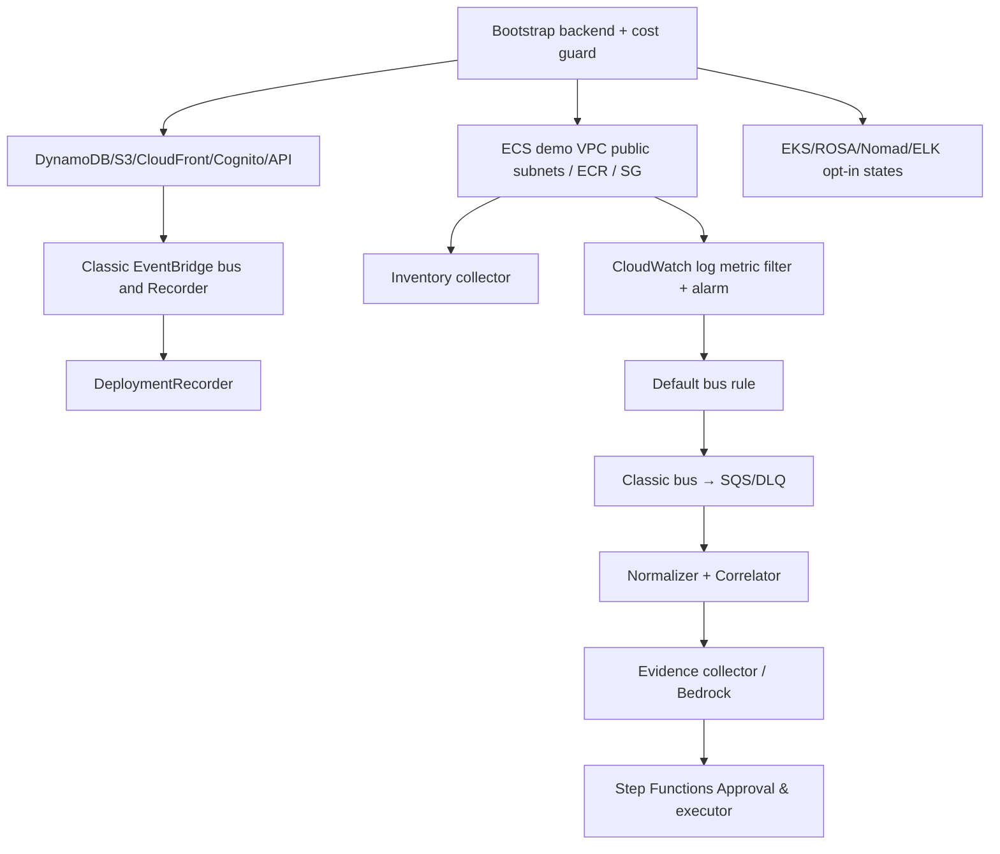

# IaC and AWS Infrastructure Contract v1.1

## Directory and state layout (required)

```text
infra/
  bootstrap/                   # Manual isolated state-bucket bootstrap; do not destroy routinely
  modules/
    cloudfront_static/
    cognito/
    api_gateway_lambda/
    dynamodb_core/
    evidence_s3/
    event_bus_classic/
    deployment_recorder/
    inventory_collector/
    audit_outbox/
    ecs_demo_public/
    cloudwatch_5xx_alarm/
    sqs_ingest/
    step_functions_approval/
    executor_restricted/
    observability_lab/
    eks_lab/
    rosa_lab/
    nomad_lab/
  environments/
    dev/core/                  # Separate backend key: cic/dev/core.tfstate
    dev/ecs-lab/               # Separate backend key: cic/dev/ecs-lab.tfstate
    lab/observability/         # cic/lab/observability.tfstate
    lab/eks/                   # cic/lab/eks.tfstate
    lab/rosa/                  # cic/lab/rosa.tfstate
    lab/nomad/                 # cic/lab/nomad.tfstate
```

All states are isolated. No state may take ownership of an AWS resource managed by another state; pass published outputs/identifiers through reviewed configuration rather than import/delete random resources. Enforce encrypted remote S3 Terraform backend with versioning and locking mechanism supported by the pinned Terraform version; restrict state access to deployment roles. Terraform versions/providers and lockfile are selected and pinned during P0, not guessed by this spec.

## Planned module dependency graph



`core` and `ecs-lab` dependencies are via explicit outputs (bus ARN, table names, service ARN), not Terraform cross-state destructive actions. A P1 event bus is part of core; ECS demo is separate lab state but must be available for P1 exit tests.

## Inputs and safeguards

| Variable | Suggested default | Constraint |
|---|---|---|
| `aws_region` | `us-east-1` | ADR-018; reject another region until a reviewed amendment; verify account/service availability |
| `environment` | `dev` | no `prod` without separate review |
| `tenant_id` | `default` | one tenant MVP only |
| `create_core` | `false` until approved | manual apply gate |
| `enable_ecs_demo` | `false` | opt-in while demo/test; stop/destroy afterwards |
| `enable_eks_lab` | `false` | manual quote and EKS quota |
| `enable_rosa_lab` | `false` | explicit cost/support prerequisite approval |
| `enable_nomad_lab` | `false` | EC2/EBS/network quote required |
| `enable_elk_lab` | `false` | memory/storage-heavy lab |
| `lab_expires_at` | none | required only when enabling a lab |
| `lab_max_runtime_hours` | `4` | plan gate, not cloud auto-shutdown guarantee |
| `bedrock_model_id` | unset | P3 must check model access/pricing |
| `core_budget_alert_usd` | `25` | AWS Budgets alert only, not cut-off |
| `owner_tag` | unset | required for each apply |

Never put connector secrets, OAuth client secret, task tokens or JWTs in `*.tfvars` committed to Git. Use Secrets Manager for third-party secrets, and audited deploy role. A Cognito SPA should use a public app client with PKCE, not an exposed client secret.

## Minimum AWS route and network configuration

- VPC one Region, 2 public subnets for ECS demo (if high-availability demo is desired), IGW default route, security group no inbound on ECS task, egress 443 + DNS needed for ECR/CloudWatch. Do not create NAT by default.
- ECS `networkMode=awsvpc`, service launch type FARGATE, `assignPublicIp=ENABLED`, image reference pinned to ECR `@sha256:...`; task execution role needs ECR image pull and CloudWatch Logs write.
- Internal synthetic HTTP client uses localhost within task, not a public listener; this is a lab load generator and not a representative internet service topology.
- CloudWatch Logs filter pattern extracted from JSON `status_code=500..599`, custom metric name `HTTP5xxCount`, alarm on threshold/treatMissingData semantics explicitly tested.
- Default EventBridge rule selects CloudWatch alarm state `ALARM` for exact alarm ARN/name, targets custom **Classic** event bus `cic-events`; bus rule fans to SQS. Rule target permissions must allow bridge to bus/queue and queue policy source rule ARN.
- Pipeline deployment recorder subscribes to same bus for `DeploymentEvent` only. Distinct rules avoid feed loops.
- API Lambdas stay out of VPC until actual private resources demand VPC interface endpoints.

## CI/CD constraints

- PR: lint/test/schema/format/Checkov/Trivy/`terraform plan` where credentials are available, **no apply**.
- Protected branch: build/test/publish only with appropriately approved environment; AWS OIDC trust restricted repo, branch, env.
- A manual release requires reviewed plan artifact and billable resource approval. No unreviewed destroy job.
