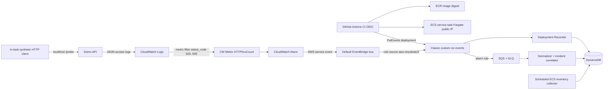

# Deterministic ECS Demo and Event Path v1.1

## Minimal AWS design

### Public subnet egress profile (demo, not a production security perimeter)

- Route table public subnet: `0.0.0.0/0 -> IGW`, route to VPC local CIDR as usual. ECS service tasks have `assignPublicIp=ENABLED` and run with `awsvpc` network mode; SG ingress rules **none**. Outbound HTTPS DNS access for ECR/CloudWatch. Public IPv4 incurs separate hourly charge.
- Demo task includes application process and a loopback HTTP load generator in **the same task**, either app background coroutine or second container using task-local `localhost`. No ALB, NAT, or public HTTP endpoint needed. It is an internal synthetic 5xx incident demo, not a web-facing customer service.
- Run healthy image (200), then bad image (500) with an environment-controlled behavior. Each HTTP request emits one structured JSON access log e.g. `{"event":"http_request","status_code":500,"request_id":"...","resource_uid":"...","occurred_at":"..."}`.
- Configure CloudWatch Logs metric filter to count JSON access logs whose `status_code` is a 5xx value. Prefer tested discrete expression/metric filter pattern, document exact AWS filter syntax in Terraform P1-08, and run fixtures against it; do not rely on an ALB target-response metric.
- Alarm `cic-demo-api-http-5xx` thresholds based on nonzero 5xx count over chosen periods and explicit missing-data policy; capture `ALARM` state transition. Avoid alarm fanout loops.
- Alarm event `source=aws.cloudwatch`, `detail-type=CloudWatch Alarm State Change` originates on EventBridge default bus; default rule forwards to **Classic custom** `cic-events`; route only specific alarm for MVP.
- P1 deployment events already use `cic-events` and recorder. P2 adds custom bus → SQS/DLQ/ingest for CloudWatch alarms. Thus P1 and P2 gates have distinct testable responsibilities.

### Security & failure proof

- Verify no inbound SG rules, no public listener reachable; only in-task HTTP client produces requests.
- Verify task can pull ECR image and write CloudWatch Logs. If it cannot, inspect subnet route, public IP, task execution role, SG egress, NACL and DNS; do not add a NAT by reflex.
- Verify EventBridge rule target policies from default bus to custom Classic bus and SQS queue are scoped; test one fixture from AWS source.
- Disable synthetic load when test ends; remove ECS service/task/public IP, confirm logs and residual S3 evidence retained only per lifecycle policy.
