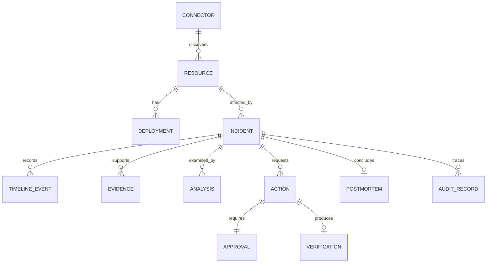

# Cloud Incident Commander — Database & Data Engineering Design

- **Mã:** CIC-DATA-001
- **Version:** 1.0 / 2026-10-15
- **Primary database:** Amazon DynamoDB on-demand
- **Object storage:** Amazon S3 (evidence, raw ingestion, postmortem, analytics)
- **Analytics:** S3 + Athena (P5); Prometheus và ELK là telemetry stores cho lab, **không phải** business source of truth.

## 1. Data modeling principles

- DynamoDB thiết kế theo **access patterns**, không ép mô hình quan hệ với joins. `cic_core` là single-table design cho aggregate, `cic_dedupe` cho event idempotency, `cic_audit` cho audit append-only.
- Mọi item chứa `tenant_id`, `entity_type`, `schema_version`, `created_at`, `updated_at` khi áp dụng; thời gian UTC ISO8601 + ULID tie-breaker.
- Mọi mutation aggregate có `version` integer, dùng condition `version = expected_version` hoặc `attribute_not_exists`.
- Bodies nặng (logs/metrics raw/AI full response/postmortem) lưu S3; core chỉ lưu metadata nhỏ, URI/ref và SHA-256. Thiết kế mỗi item tránh giới hạn kích cỡ DynamoDB (400 KB).
- AWS credentials, JWT, approval callback token bản rõ, PII không được lưu như evidence. Nếu lưu callback token để resume Step Functions, lưu ciphertext (KMS envelope encryption) với TTL 30 phút, IAM chỉ role approval service được decrypt.
- Sử dụng UUID/ULID độc lập với external IDs để tránh trường hợp source IDs không unique giữa hệ thống.

## 2. Entity relationship (logic)


Đây là quan hệ logic, **không có foreign key/SQL joins**. Referential integrity được thực thi ở domain/service layer và conditional transactions.

## 3. Physical tables

### Table A — `cic_core`

Primary key `PK` (String) + `SK` (String), on-demand, PITR enable khi khả dụng theo budget, DynamoDB Streams để phục vụ export/outbox (không dùng làm audit immutable).

| Entity | PK | SK | Important fields |
|---|---|---|---|
| Incident | `INCIDENT#<incident_id>` | `META` | tenant_id, resource_uid, status, severity, title, fingerprint, first_seen_at, last_seen_at, created_at, updated_at, version, assignee_id, latest_deployment_id |
| Timeline | `INCIDENT#<id>` | `TIMELINE#<ISO8601>#<event_ulid>` | event_id, type, actor_id, source, summary, details_ref, occurred_at, ingested_at |
| Evidence | `INCIDENT#<id>` | `EVIDENCE#<evidence_id>` | evidence_type, occurred_at, s3_key, sha256, byte_size, redaction_status, collection_status |
| Analysis | `INCIDENT#<id>` | `ANALYSIS#<analysis_id>` | status, model_id, prompt_version, evidence_ids, top_hypothesis, report_s3_key, created_at |
| Action | `INCIDENT#<id>` | `ACTION#<action_id>` | action_type, resource_uid, expected_revision, target_revision, status, idempotency_key, requester_id, approved_by, workflow_execution_arn, version |
| Approval | `INCIDENT#<id>` | `APPROVAL#<approval_id>` | action_id, status, requester_id, approver_id, reason, policy_version, expires_at, token_ciphertext_ref, version |
| Verification | `INCIDENT#<id>` | `VERIFICATION#<action_id>` | status, checks[], began_at, completed_at, alarm_state, actual_revision |
| Postmortem | `INCIDENT#<id>` | `POSTMORTEM#v<integer>` | author_id, state, report_s3_key, generated_at, reviewed_at |
| Resource | `RESOURCE#<resource_hash>` | `META` | resource_uid, provider, platform, region, account_id, env, name, owner, allowed_actions, last_seen_at, version |
| Deployment | `RESOURCE#<resource_hash>` | `DEPLOYMENT#<ISO8601>#<deployment_id>` | commit_sha, repo, scm_provider, pipeline_provider, run_id, image_digest, task_definition_arn, status |
| Fingerprint lock | `FINGERPRINT#<sha256>` | `ACTIVE` | incident_id, status, last_seen_at, lock_version |
| Connector | `TENANT#<tenant_id>` | `CONNECTOR#<connector_id>` | provider, type, status, secret_arn (never secret), last_heartbeat, config_s3_key |
| Policy | `TENANT#<tenant_id>` | `POLICY#<policy_id>` | action_type, resource_pattern/allowlist, approver_roles, version, effective_at |
| Outbox event | `INCIDENT#<id>` | `OUTBOX#<event_ulid>` | type, payload_ref, publish_status, retries, created_at |

`resource_hash = SHA256(canonical_resource_uid)` (or shorter collision-resistant deterministic encoded digest); always keep original resource UID field to verify matches.

#### Secondary indexes (sparse)

| Index | Partition key | Sort key | Written on | Access pattern |
|---|---|---|---|---|
| GSI1 `status-updated-index` | `GSI1PK = TENANT#<id>#INCIDENT_STATUS#<status>` | `GSI1SK = <updated_at>#<incident_id>` | Incident META only | List incidents by status newest first; severity filter in app or separate derived facets later |
| GSI2 `resource-incidents-index` | `GSI2PK = TENANT#<id>#RESOURCE#<resource_hash>` | `GSI2SK = <created_at>#<incident_id>` | Incident META only | Incidents impacting specific resource |
| GSI3 `work-queue-index` | `GSI3PK = TENANT#<id>#APPROVAL#PENDING` OR `TENANT#<id>#OUTBOX#PENDING` | `GSI3SK = <created_at>#<item_id>` | Pending APPROVAL / pending OUTBOX only | Work queues; app filters approvals again by resource authorization |

GSI reads are **eventually consistent**. Do not use GSI presence as the sole proof of unique incident, approval execution, or current revision; use strongly consistent GetItem on primary keys and conditional writes. `last_evaluated_key` cursor is encoded/validated server-side.

### Table B — `cic_dedupe`

- PK: `event_key = TENANT#<id>#SOURCE#<source>#EVENT#<event_id>`.
- Attributes: `status (PROCESSING|COMMITTED)`, `incident_id`, `fingerprint`, `first_seen_at`, `last_attempt_at`, `expires_at_epoch` (DynamoDB TTL, default 7 days).
- Conditional write to claim event. On worker retry and PROCESSING stale lease, either reconcile with existing timeline event or recover transaction, not simply drop.
- EventBus at-least-once, webhook replay, Lambda retries all expected. TTL deletes **eventually** (not exact deadline); expired marker must be interpreted as invalid in code even before physical delete.

### Table C — `cic_audit`

- PK: `TENANT#<id>#MONTH#YYYY-MM`.
- SK: `TS#<ISO8601>#<ULID>`.
- Data: `audit_id`, `actor_type`, `actor_id`, `source_ip_hash`, `correlation_id`, `request_id`, `action`, `resource_uid`, `incident_id`, `before_digest`, `after_digest`, `outcome`, `reason`, `policy_version`, `workflow_execution_arn`, `created_at`.
- Dedicated IAM writer role gets `dynamodb:PutItem` + ConditionExpression `attribute_not_exists(PK) AND attribute_not_exists(SK)` only; **no UpdateItem/DeleteItem**.
- Mọi mutation đặc quyền transactionally ghi thay đổi `cic_core` **cùng** một `OUTBOX#...` item. Audit writer đọc outbox và PutItem idempotent vào `cic_audit`; lỗi chuyển audit được retry/DLQ, không silently dropped. Chỉ khi audit row thực sự tồn tại mới coi audit delivered.
- Export audit objects with checksums daily to private S3 (P5). This is tamper-resistant by application IAM policy, **not cryptographically immutable** unless S3 Object Lock or stronger controls are separately configured.
- Admin audit query by month key, bounded time range. Actor lookup via application-level filtering for small lab; add GSI if measured need justifies.

## 4. Concrete JSON item samples

### Incident META
```json
{
  "PK": "INCIDENT#01JINC001",
  "SK": "META",
  "entity_type": "INCIDENT",
  "schema_version": 1,
  "tenant_id": "default",
  "incident_id": "01JINC001",
  "resource_uid": "aws:us-east-1:123456789012:ecs:cluster/demo:service/api",
  "resource_hash": "sha256-of-resource-uid",
  "fingerprint": "sha256-of-deduped-alert",
  "title": "Elevated 5xx on demo/api after deployment",
  "status": "INVESTIGATING",
  "severity": "SEV2",
  "first_seen_at": "2026-10-15T08:30:00Z",
  "last_seen_at": "2026-10-15T08:30:00Z",
  "created_at": "2026-10-15T08:30:06Z",
  "updated_at": "2026-10-15T08:31:00Z",
  "latest_deployment_id": "01JDEP001",
  "version": 4,
  "GSI1PK": "TENANT#default#INCIDENT_STATUS#INVESTIGATING",
  "GSI1SK": "2026-10-15T08:31:00Z#01JINC001",
  "GSI2PK": "TENANT#default#RESOURCE#sha256-of-resource-uid",
  "GSI2SK": "2026-10-15T08:30:06Z#01JINC001"
}
```

### Approval item
```json
{
  "PK":"INCIDENT#01JINC001",
  "SK":"APPROVAL#01JAPR001",
  "entity_type":"APPROVAL",
  "tenant_id":"default",
  "status":"PENDING",
  "action_id":"01JACT001",
  "requester_id":"cognito-sub-a",
  "approver_id":null,
  "policy_version":"2026-10-15-1",
  "expires_at":"2026-10-15T09:00:00Z",
  "version":1,
  "GSI3PK":"TENANT#default#APPROVAL#PENDING",
  "GSI3SK":"2026-10-15T08:30:00Z#01JAPR001"
}
```

### Audit item
```json
{
  "PK":"TENANT#default#MONTH#2026-10",
  "SK":"TS#2026-10-15T08:44:09.123Z#01JAUD001",
  "audit_id":"01JAUD001",
  "actor_type":"USER",
  "actor_id":"cognito-sub-b",
  "action":"APPROVE_REMEDIATION",
  "resource_uid":"aws:us-east-1:123456789012:ecs:cluster/demo:service/api",
  "incident_id":"01JINC001",
  "correlation_id":"01JCOR001",
  "outcome":"ALLOWED",
  "reason":"Approved rollback after evidence review",
  "created_at":"2026-10-15T08:44:09.123Z"
}
```

## 5. Critical access patterns

| ID | Query | Implementation | Consistency need |
|---|---|---|---|
| AP-01 | Load incident detail | `GetItem(PK=INCIDENT#id, SK=META)` | Strong (mutations/approval) |
| AP-02 | Paginated list by status | GSI1 Query with tenant+status | Eventual okay for dashboard |
| AP-03 | Incident timeline | Query `PK=INCIDENT#id`, `begins_with(SK,'TIMELINE#')` | Strong possible |
| AP-04 | Incident evidence and AI | Prefix queries on same PK | Strong after write |
| AP-05 | Find affected resource history | GSI2 Query | Eventual okay |
| AP-06 | Resource and latest deployments | Query `PK=RESOURCE#hash`, SK prefixes | Strong when establishing action target |
| AP-07 | Global pending approvals | GSI3 Query + authorization filter | Eventual for listing, strong for decision |
| AP-08 | Fingerprint uniqueness | `GetItem(PK=FINGERPRINT#hash, SK=ACTIVE)` + atomic condition | Strong mandatory |
| AP-09 | Event idempotency | Conditional Put on `cic_dedupe` and core transaction | Strong/transaction |
| AP-10 | Daily audit by date range | `cic_audit` month key + bounded SK | Strong optional |
| AP-11 | Outbox publisher pending | GSI3 Query `TENANT#...#OUTBOX#PENDING` | Eventual, retry safe |

Important: avoid `Scan` in any runtime endpoint. A status filter beyond GSI design (e.g. cross-status search) may require fan-out 6 fixed status keys, merge/sort and paginate carefully, or later OpenSearch search index; MVP UI defaults to status-specific lists.

## 6. Idempotent incident creation transaction

Pseudocode (exact expressions to implement/test):

```python
async def handle_signal(evt):
    key = dedupe_key(evt)
    fp = fingerprint(evt)
    # Strong-read canonical fingerprint lock (not GSI).
    lock = await get_fingerprint(fp, consistent=True)
    if lock and lock.status == 'OPEN' and minutes_since(lock.last_seen_at) <= 10:
        incident_id = lock.incident_id
        await transact_write_if_new_event(
            conditional_dedupe_key=key,
            timeline_item=build_timeline(evt, incident_id),
            update_last_seen_and_incident_version=incident_id,
            fingerprint_key=fp,
        )
    else:
        incident_id = new_ulid()
        await transact_write_if_new_event_and_new_incident(
            conditional_dedupe_key=key,
            compare_and_swap_fingerprint_lock=lock,
            incident_meta=build_incident(evt, incident_id),
            timeline_item=build_timeline(evt, incident_id),
            outbox_item=build_outbox_event(evt, incident_id),
        )
    # Retry transaction conflicts, never perform unsafe double action.
```

- Open fingerprint lock `status=OPEN` được release/mark `CLOSED` khi incident đóng; out-of-window cùng fingerprint mở incident mới sau 10 phút dù incident trước có thể chưa đóng (chính sách v1 để tránh incident kéo dài vô hạn). Không sử dụng `fingerprint` làm global uniqueness vĩnh viễn.
- Transaction conflicts được retry có jitter. `TransactWriteItems` được dùng khi thao tác cross-items để tránh ghi dedupe rồi fail incident. Outbox dispatcher gửi EventBridge rồi mark published; event downstream cũng idempotent.
- Cross-tenant uniqueness: fingerprint phải bao gồm tenant ID.

## 7. S3 layout & lifecycle

```text
s3://cic-evidence-<account>-<region>/
├── raw/events/year=YYYY/month=MM/day=DD/source=.../<event_id>.json
├── evidence/tenant=default/incident=<id>/logs/<ev_id>.json.gz
├── evidence/tenant=default/incident=<id>/metrics/<ev_id>.json.gz
├── evidence/tenant=default/incident=<id>/deployments/<ev_id>.json
├── analysis/tenant=default/incident=<id>/<analysis_id>.json
├── postmortems/tenant=default/incident=<id>/v1.md
└── exports/tenant=default/year=YYYY/month=MM/day=DD/incidents-....jsonl.gz

s3://cic-audit-<account>-<region>/
└── tenant=default/year=YYYY/month=MM/day=DD/audit-<batch_id>.jsonl.gz
```

- Private bucket, block public access, HTTPS-only, SSE-S3 default; SSE-KMS selectively for secrets-sensitive data and callback tokens. Audit KMS costs before opting in.
- Object metadata contains schema version + SHA256 digest, not identifying data as S3 tags.
- CloudWatch app logs: 14 days (deployment setting). Evidence S3: expire after 90 days for **lab only**; audit: retain at least 365 days; postmortem retain until intentional deletion. Use different lifecycle rules per prefix; not one blanket lifecycle.
- S3 versioning for critical paths. Expiration of versioned objects can create delete markers, configure NoncurrentVersionExpiration explicitly after reviewing retention requirements; do not assert immediate deletion/cost savings.
- Nightly (P5) partitioned exports to S3 for Athena; partition date from event occurred_at and avoid leaking unredacted payload into analytics.

## 8. Analytics data marts (P5)

S3 curated Parquet with Glue Catalog/Athena tables:

```text
fact_incidents(tenant_id,incident_id,resource_uid,platform,severity,created_at,
               acknowledged_at,resolved_at,closed_at,detection_seconds,
               acknowledgement_seconds,resolution_seconds,action_type,verification_status)
fact_deployments(tenant_id,deployment_id,resource_uid,provider,commit_sha,
                 image_digest,deployed_at,status)
fact_actions(tenant_id,action_id,incident_id,action_type,requested_at,
             approved_at,completed_at,status,verification_status)
dim_resources(tenant_id,resource_uid,platform,environment,owner,region)
```

- MTTD = avg detection_seconds over incidents with known signal start; MTTA = avg acknowledged_at-created_at; MTTR = avg resolved_at-created_at. Exclude null; report sample size; define denominator and timezone in UI.
- `fact` views aggregate by day/week, severity, resource/platform, deployments; no SQL joins against live DynamoDB in request path.

## 9. State enums / validation

```text
Incident.status: NEW | ACKNOWLEDGED | INVESTIGATING | MITIGATING | RESOLVED | CLOSED
Severity: SEV1 | SEV2 | SEV3 | SEV4
Investigation.status: QUEUED | RUNNING | COMPLETE | INCONCLUSIVE | FAILED
Approval.status: PENDING | APPROVED | REJECTED | EXPIRED | CANCELLED
Action.status: PENDING_APPROVAL | APPROVED | PRECHECK | EXECUTING | VERIFYING | SUCCEEDED | FAILED | CONFLICT | CANCELLED
Verification.status: VERIFIED | FAILED | UNKNOWN
Connector.status: ENABLED | DISABLED | ERROR
```
Every transition validated by domain logic, actor authorization and optimistic version; observed state persisted with UTC and trace ID.

## 10. Data tests and migration policy

- Property tests for fingerprint deterministic mapping; duplicates; out-of-order events; stale/version-conflicting updates; tenant isolation.
- Contract tests for Pydantic/JSON schema v1; future events additive or new `schema_version` with conversion adapters.
- Restore test: DynamoDB PITR/backup or export, S3 versioned objects, reconciliation counts; no full production restore via `terraform destroy`.
- Audit tests ensure service writer IAM can't call UpdateItem/DeleteItem; create identical SK twice yields conditional failure.
- P5 analytics reconciles total unique incidents per day with DynamoDB; tolerates eventual export lag and reports freshness.

## 11. Sources / constraints

- DynamoDB TTL is asynchronous (expired items may take days to delete): https://docs.aws.amazon.com/amazondynamodb/latest/developerguide/TTL.html
- GSI supports eventual consistency only: https://docs.aws.amazon.com/amazondynamodb/latest/developerguide/HowItWorks.ReadConsistency.html
