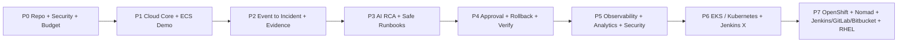

# Cloud Incident Commander — Implementation Backlog v1.0

- **Ngày chốt:** 2026-10-15
- **Delivery approach:** vertical slices (mỗi phase kết thúc với 1 demo tự chạy)
- **Planning unit:** 1 story point là ước tính độ phức tạp tương đối, **không phải** số giờ.
- **MVP = P0..P4**, Full scope = P0..P7.
- **Các thời lượng** là dự toán lập kế hoạch nếu có thời gian làm việc tập trung; không phải cam kết tiến độ. Làm cá nhân bán thời gian có thể dài hơn đáng kể.

## 1. Roadmap & Gates

| Phase | Objective | Duration estimate | Exit gate |
|---|---|---|---|
| P0 — Foundation & Scope | Repo/contracts, ADR/SRS, CI checks, budget, threat model | ~1 tuần | P1 có thể bắt đầu khi codebase + remote state/cost guards sẵn |
| P1 — AWS Foundation + demo workload | CloudFront/S3 web; Cognito; Lambda/FastAPI; DynamoDB; ECS bad/good releases | ~2 tuần | Login thực, demo ECS hoạt động và deployment event về CIC |
| P2 — Detect + Investigate Evidence | Alarm/CI event -> normalized signal -> incident/timeline -> S3 evidence | ~2 tuần | Một lỗi ECS tạo đúng incident dưới 120s sau EventBridge; duplicate test pass |
| P3 — AI RCA + Safe Recommendations | Bedrock RCA trả evidence refs, uncertainty, proposal không có quyền thực thi | ~1–2 tuần | AI output schema valid, hallucination evidence/action bị reject |
| P4 — Human-approved Remediation — MVP Gate | Approval -> Step Functions -> guarded ECS rollback -> verification -> postmortem | ~2–3 tuần | UAT-01..10 pass, thực thi không bypass approval, recovery và audit đầy đủ |
| P5 — Security/Observability/Data | Prometheus/Grafana/ELK, CloudTrail/GuardDuty, Athena analytics, DR drill | ~2–3 tuần | Dashboard correlate, security signal và log explorer thực, dữ liệu báo cáo đối soát |
| P6 — Kubernetes/EKS + Jenkins X | EKS opt-in, read-only adapter, GitOps rollout & incident | ~2–3 tuần | Cluster thật có workload lỗi được CIC nhận diện, lab teardown sạch |
| P7 — OpenShift/Nomad/CI/SCM/RHEL Integration | ROSA/OpenShift, Nomad, Jenkins/GitLab CI/Bitbucket, Packer/Ansible/RHEL | ~4–6 tuần | Mỗi công nghệ chạy thử thật trên AWS có event/output đến CIC, báo cáo cost và teardown |

## 2. Definition of Done cho mọi story

- Có issue ID, mô tả, liên kết FR/NFR hoặc ADR, acceptance criteria được chứng minh.
- Code compile/build, lint/typecheck pass, unit tests pass; contract tests khi schema thay đổi.
- Scan dependency/container/IaC pass hoặc có exception documented kèm TTL.
- Không chứa static AWS access key, password, secret, token trong source/log/PR.
- Có IAM boundary, observability (log/trace/error), rollback/cleanup runbook nếu thay đổi AWS.
- README và Terraform được cập nhật; tự đánh giá cost trước apply.
- PR reviewed, merge protected branch; evidence nghiệm thu đính kèm issue.

## 3. Ordered stories & Dependencies

### P0 — Foundation & Scope (6 stories; 20 points)

| Issue | Priority | Task | Depends on | SP | Acceptance criteria |
|---|---|---|---|---:|---|
| `P0-01` | Must | Baseline SRS/architecture/DB, FR/NFR & ADR | — | 3 | Tài liệu version 1.0; requirement traceability; scope AWS-only; review security/cost |
| `P0-02` | Must | Khởi tạo monorepo Next.js/FastAPI/Python packages | P0-01 | 3 | npm/pnpm + uv lockfiles; typed lint/format; dev chạy từ README |
| `P0-03` | Must | Pydantic contracts, OpenAPI v1 & JSON schema events | P0-02 | 3 | SignalEvent, DeploymentEvent, Incident, Action schemas; roundtrip contract tests |
| `P0-04` | Must | Define roles, trust boundaries & threat model | P0-01 | 3 | Viewer/Operator/Approver/Admin policy matrix + abuse cases + no AI AWS access |
| `P0-05` | Must | Terraform state isolation, AWS Budget & tagging | P0-01 | 5 | Separate core/lab state; budget alert; mandatory tags and TTL; destroy instructions |
| `P0-06` | Must | CI checks GitHub Actions (no AWS static key) | P0-02 | 3 | PR lint/typecheck/test/secret scan; protected branch; AWS OIDC trust restricted |

**Exit gate P0:** P1 có thể bắt đầu khi codebase + remote state/cost guards sẵn.

### P1 — AWS Foundation + demo workload (8 stories; 38 points)

| Issue | Priority | Task | Depends on | SP | Acceptance criteria |
|---|---|---|---|---:|---|
| `P1-01` | Must | Terraform CloudFront + private S3 + OAC | P0-05 | 5 | Next.js export loads via CloudFront HTTPS, S3 BlockPublicAccess, no public S3 origin |
| `P1-02` | Must | Cognito Hosted UI + PKCE + RBAC backend | P0-04,P1-01 | 5 | Sign-in/out, no tokens in logs; 401/403 tests, MFA for approver/admin where configured |
| `P1-03` | Must | Terraform DynamoDB core/dedupe/audit + indices | P0-03,P0-05 | 5 | PK/SK/GSI definitions & PITR config; integration test against AWS or DynamoDB Local |
| `P1-04` | Must | Deploy FastAPI/Mangum HTTP API Lambda | P1-02,P1-03 | 5 | GET /healthz, protected /v1/resources; proper CORS, trace IDs, logs 14d |
| `P1-05` | Must | Docker sample API + ECR + ECS Fargate | P0-06,P0-05 | 5 | Pinned digest release; configurable healthy/faulty mode; safe lab rollback revision |
| `P1-06` | Must | Build/test/scan/deploy demo with GitHub Actions OIDC | P1-05 | 5 | Trivy scan, SHA/digest, approvals protected env; publish DeploymentEvent |
| `P1-07` | Must | Web layout / login / resources / deployment history | P1-01,P1-02,P1-04 | 5 | Authenticated shell responsive; loading/error states; resource list real data |
| `P1-08` | Must | CloudWatch basic alarms + app logs + cost dashboard | P1-04,P1-05 | 3 | ECS/API error metrics+retention+alarms; no costly NAT by default |

**Exit gate P1:** Login thực, demo ECS hoạt động và deployment event về CIC.

### P2 — Detect + Investigate Evidence (8 stories; 44 points)

| Issue | Priority | Task | Depends on | SP | Acceptance criteria |
|---|---|---|---|---:|---|
| `P2-01` | Must | EventBridge bus + SQS + DLQ + Lambda consumer | P1-03,P1-08 | 5 | Filtered alarm → queue, retries, DLQ, replay runbook |
| `P2-02` | Must | Normalize AWS alarm & deployment events | P0-03,P2-01 | 5 | Schema version, timestamps, IDs, resource UID, sample fixtures |
| `P2-03` | Must | Idempotent dedupe + fingerprint/incident correlation | P2-02 | 8 | Five duplicate deliveries → one incident; race/out-of-order tests; transactions |
| `P2-04` | Must | Incident state machine, severity & timeline | P2-03 | 5 | Transition validation, RBAC, optimistic version, append timeline |
| `P2-05` | Must | Bounded CloudWatch/ECS evidence collector | P2-03 | 8 | Read-only IAM, constrained time/size, redaction, partial failures |
| `P2-06` | Must | Evidence manifest S3 + metadata digest in DynamoDB | P2-05 | 3 | Private encryption, SHA-256, presigned retrieval RBAC |
| `P2-07` | Must | Incident dashboard/list/detail + timeline/evidence tabs | P2-04,P2-06 | 5 | Pagination without Scan, filter status/severity, no leaked private objects |
| `P2-08` | Must | Integration scenario alarm → incident → evidence | P2-01,P2-07 | 5 | CloudWatch injected demo alarm; incident correct resource and commit SHA < 120s after bus |

**Exit gate P2:** Một lỗi ECS tạo đúng incident dưới 120s sau EventBridge; duplicate test pass.

### P3 — AI RCA + Safe Recommendations (6 stories; 26 points)

| Issue | Priority | Task | Depends on | SP | Acceptance criteria |
|---|---|---|---|---:|---|
| `P3-01` | Must | Bedrock model config, IAM, budget/token guardrails | P2-06 | 3 | Selected region/model access, cost limits, sanitized evidence |
| `P3-02` | Must | Evidence curation, redaction and prompt schema | P3-01 | 5 | Untrusted logs treated data, bounded context, prompt-injection test |
| `P3-03` | Must | Bedrock investigator async + JSON schema validation | P3-02 | 5 | RCA with existing evidence IDs; confidence labels; status COMPLETE/INCONCLUSIVE |
| `P3-04` | Must | Runbook catalog and deterministic validator | P3-03 | 5 | Only ecs.rollback_task_definition accepted; no arbitrary command |
| `P3-05` | Must | AI analysis UI with supporting evidence and risk | P3-03 | 3 | Citations are clickable evidence refs; status/uncertainty visible |
| `P3-06` | Must | AI evaluation: fabricated evidence / unsafe action tests | P3-04,P3-05 | 5 | Hallucination refs rejected; prompt injection cannot trigger action |

**Exit gate P3:** AI output schema valid, hallucination evidence/action bị reject.

### P4 — Human-approved Remediation — MVP Gate (9 stories; 52 points)

| Issue | Priority | Task | Depends on | SP | Acceptance criteria |
|---|---|---|---|---:|---|
| `P4-01` | Must | Approval policy (RBAC, resource allowlist, separation of duty) | P3-04 | 5 | Requester!=approver, expiry, resource action scope; negative tests |
| `P4-02` | Must | Step Functions Standard approval callback workflow | P4-01 | 8 | Encrypted task token server only, timeout and reject safe |
| `P4-03` | Must | Approval endpoints and pending approval UI | P4-02 | 5 | Duplicate decision idempotent, stale version 409, audit recorded |
| `P4-04` | Must | Remediation resource lock/idempotency + preflight | P4-02 | 8 | Read latest ECS revision and compare snapshot; blocked on drift, deny by default |
| `P4-05` | Must | Restricted ecs.rollback_task_definition executor | P4-04 | 5 | Approved historical revision only; IAM scoped exact service ARN |
| `P4-06` | Must | ECS stabilization + alarm steady-state verification | P4-05 | 5 | 5m verification window, VERIFIED/FAILED/UNKNOWN incl missing metric |
| `P4-07` | Must | DynamoDB append-only audit + state/action timeline | P4-03,P4-06 | 5 | Every mutation actor/outcome/trace, writer cannot update/delete |
| `P4-08` | Must | Generate editable postmortem from timeline/evidence | P4-07 | 3 | Export Markdown, root-cause uncertainty and follow-ups |
| `P4-09` | Must | Complete bad-release UAT incl no-self-approval/drift | P4-08 | 8 | UAT-01..10 pass; intentionally injected drift prevents action; cleanup tested |

**Exit gate P4:** UAT-01..10 pass, thực thi không bypass approval, recovery và audit đầy đủ.

### P5 — Security/Observability/Data (9 stories; 40 points)

| Issue | Priority | Task | Depends on | SP | Acceptance criteria |
|---|---|---|---|---:|---|
| `P5-01` | Should | Add Prometheus exporters and scrape config for lab | P4-09 | 5 | Demo metric observable with labels/resource UID, retention cap |
| `P5-02` | Should | Grafana dashboards correlated with incident IDs | P5-01 | 3 | Dashboard panels linked from incident, access controlled |
| `P5-03` | Should | ELK on AWS EC2/Docker: Elasticsearch, Logstash, Kibana | P4-09,P0-05 | 8 | Real workload logs indexed and queryable, secure endpoint, lifecycle cleanup |
| `P5-04` | Should | GuardDuty high severity finding and CloudTrail event adapters | P2-02,P4-09 | 5 | Typed security signal, no auto mutation; filters reduce noise and cost |
| `P5-05` | Should | DynamoDB/S3 export to Parquet + Glue/Athena | P4-09 | 5 | Daily partition export, schema and count reconciliation |
| `P5-06` | Should | MTTD/MTTA/MTTR dashboard with stated denominator | P5-05 | 3 | Query measured facts, null excluded, freshness label |
| `P5-07` | Should | SNS/email incident & approval notification | P4-03 | 3 | No secret/token email, subscription choices, anti-spam |
| `P5-08` | Should | Trivy + Checkov gate and secrets/config review | P0-06,P4-09 | 3 | Critical results fail pipeline with documented exception policy |
| `P5-09` | Should | DLQ replay, backup/restore drill, threat-model revisit | P5-04,P5-05 | 5 | Restore evidence/accounting, replay is idempotent, RPO/RTO measured |

**Exit gate P5:** Dashboard correlate, security signal và log explorer thực, dữ liệu báo cáo đối soát.

### P6 — Kubernetes/EKS + Jenkins X (6 stories; 39 points)

| Issue | Priority | Task | Depends on | SP | Acceptance criteria |
|---|---|---|---|---:|---|
| `P6-01` | Should | Terraform EKS opt-in + cluster cleanup/cost gates | P5-09 | 8 | On-demand plan/apply/destroy, no always-on cluster; quotas validated |
| `P6-02` | Should | Deploy demo app on EKS (Docker + manifests) | P6-01 | 5 | Real app healthy/faulty revision, namespace RBAC, metrics/events |
| `P6-03` | Should | Kubernetes read-only inventory/events adapter | P6-02,P2-02 | 8 | Deployment unavailable/CrashLoopBackOff arrives as normalized event |
| `P6-04` | Should | EKS IAM/service account boundary & adapter auth | P6-03 | 5 | Least privilege cluster RBAC, no static kubeconfig leaked |
| `P6-05` | Should | Run Jenkins X GitOps demo on EKS | P6-02 | 8 | End-to-end GitOps release event linked to incident with commit SHA |
| `P6-06` | Should | EKS failed rollout end-to-end and cost teardown | P6-03,P6-05 | 5 | Create real incident; evidence of Kubernetes event and Jenkins X release |

**Exit gate P6:** Cluster thật có workload lỗi được CIC nhận diện, lab teardown sạch.

### P7 — OpenShift/Nomad/CI/SCM/RHEL Integration (12 stories; 69 points)

| Issue | Priority | Task | Depends on | SP | Acceptance criteria |
|---|---|---|---|---:|---|
| `P7-01` | Could | Packer hardened RHEL AMI in AWS | P0-05,P5-08 | 5 | AMI immutable version, base hardening, vulnerability scan evidence |
| `P7-02` | Could | Ansible config runner/Nomad/ELK on RHEL EC2 | P7-01 | 5 | Idempotent playbook, no plaintext secret, rerun without drift |
| `P7-03` | Could | Nomad server/client cluster lab on AWS EC2 | P7-02 | 8 | Nomad sample job scheduled, failure/recovery captured, teardown |
| `P7-04` | Could | Nomad allocation/deploy adapter | P7-03 | 5 | Failed allocation emits verified canonical signal linked to resource |
| `P7-05` | Could | Jenkins controller/runner lab on EC2 | P7-02 | 5 | Pipeline builds/scans/deploys lab workload with secrets masked |
| `P7-06` | Could | GitLab CI runner hosted on AWS, pipeline demo | P7-02 | 5 | Real pipeline checks build/test; event correlated by SHA |
| `P7-07` | Could | Connect GitLab + Bitbucket + GitHub repositories | P7-05,P7-06 | 5 | Verified webhook, repo/commit/run mapping; no untrusted actions |
| `P7-08` | Could | Provision OpenShift/ROSA on AWS with cost approval | P0-05,P6-06 | 8 | Support/quotas/budget checked; real OpenShift cluster reachable; destroyed after lab |
| `P7-09` | Could | OpenShift deployment/event/metric adapter | P7-08 | 8 | Real OpenShift rollout failure creates correctly linked incident |
| `P7-10` | Could | Connect Nomad/OpenShift/EKS lab logs to ELK | P5-03,P7-04,P7-09 | 5 | Search same failure request ID across sources; retention capped |
| `P7-11` | Could | One multi-platform incident comparison dashboard | P7-04,P7-07,P7-09 | 5 | Same UI schema for ECS/EKS/OpenShift/Nomad; provider specific labels |
| `P7-12` | Could | Final portfolio demonstrations, ADRs, cost report, teardown | P7-10,P7-11 | 5 | Video/script/scenarios, measured cost, reproducible apply and destroy |

**Exit gate P7:** Mỗi công nghệ chạy thử thật trên AWS có event/output đến CIC, báo cáo cost và teardown.

## 4. Dependency critical path

**Có thể song song trong mỗi phase:** web UI với backend contract; Infra Terraform với domain unit tests; observability với analytics; integrations Jenkins/GitLab/Bitbucket với Packer/RHEL sau P7-02. **Không song song:** executor trước RBAC/approval/preflight, AI trước evidence, expensive lab trước budget gate.

## 5. Sprint/deliverable milestones

- **Milestone M1 (end P1):** Login → Dashboard → ECS demo deployed; full AWS foundation operational.
- **Milestone M2 (end P2):** Deploy faulty release → CloudWatch → Incident + timeline + S3 evidence.
- **Milestone M3 (end P3):** Incident → Bedrock RCA (grounded evidence, no execution).
- **Milestone M4 (end P4):** Full incident response demo (approved rollback, verify, audit, postmortem) = **MVP release v1.0**.
- **Milestone M5 (end P5):** Security observability analytics ready for portfolio.
- **Milestone M6 (end P6):** Kubernetes/EKS & Jenkins X demo real.
- **Milestone M7 (end P7):** All 6-image technologies proven through real integration tests on AWS.

## 6. Required quality and failure tests

| ID | Failure to inject | Expected safe outcome |
|---|---|---|
| NEG-01 | SQS duplicate x5 / out-of-order | Single idempotent timeline per event, one incident per correlation window |
| NEG-02 | Bedrock hallucinates `evidence_id` | Reject invalid analysis, no action |
| NEG-03 | Viewer calls approve API | HTTP 403, audit denied |
| NEG-04 | Requester approves own action | HTTP 403, no state change |
| NEG-05 | ECS revision changed after approval request | Preflight fails closed, no UpdateService |
| NEG-06 | Concurrent rollback requests | One lock winner, second conflict without mutation |
| NEG-07 | Timeout/no CloudWatch metrics after rollback | Verification UNKNOWN/FAILED, never assert success |
| NEG-08 | Expired/duplicate SF callback | Request rejected, only one executor execution |
| NEG-09 | Compromised webhook wrong HMAC | 401/403, no EventBridge publish |
| NEG-10 | Unauthorized cross-resource action | Policy denies even Admin without specific authorization |
| NEG-11 | ECS/EKS/ROSA lab cleanup | Only lab state/resources removed; core intact |

## 7. Release strategy

- Git tags: `v0.1.0` (P1), `v0.2.0` (P2), `v0.3.0` (P3), `v1.0.0-mvp` (P4), `v1.1.0` (P5), `v1.2.0` (P6), `v2.0.0-labs` (P7).
- Release requires tests, security checks, terraform plan and deployment manifest pinned by git SHA & ECR image digest.
- Production deploy requires protected GitHub Environment reviewers; no direct IAM user key. Human approval for remediation independent of CI deploy review.
- CI platform integration tests must never become dependencies of the core production deployment pipeline.

## 8. Scope change and cost policy

- **Do not provision P6/P7 services by default.** Terraform `enable_eks=false`, `enable_rosa=false`, `enable_nomad=false`, `enable_elk=false`, `enable_jenkins=false` until explicit budget approval.
- A phase with missing real technology is marked PARTIAL/BLOCKED with reason; mock result does not count as integration completion.
- End every lab with cost and teardown report, including EC2/EBS/ELB/EIP/NAT/CloudWatch artifacts that might survive destroy.
